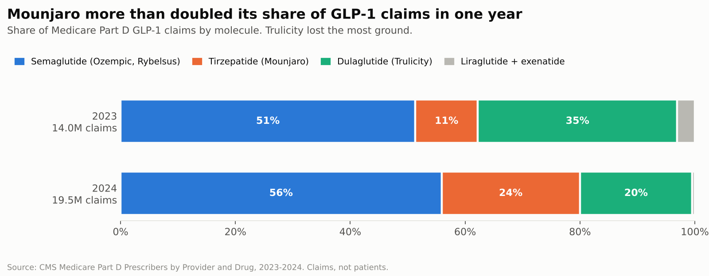
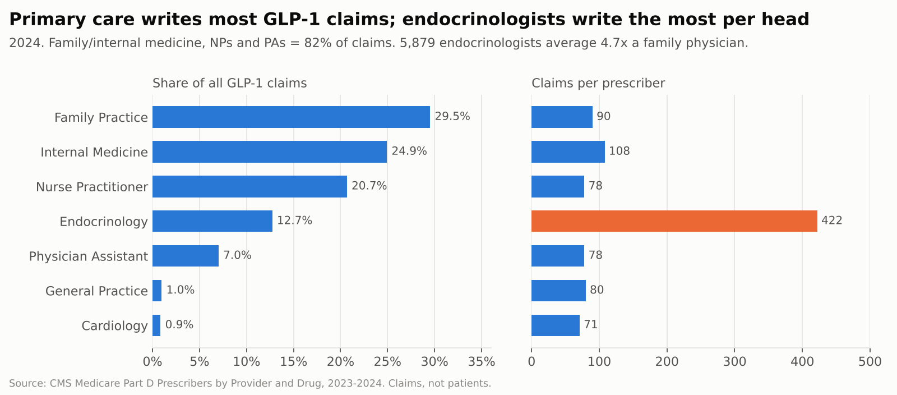
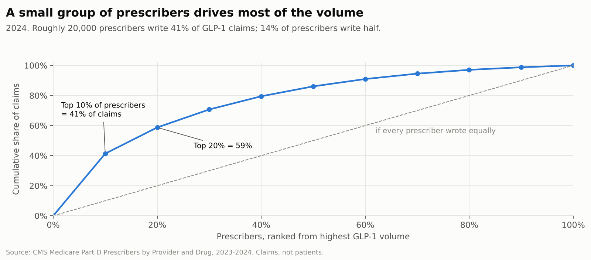
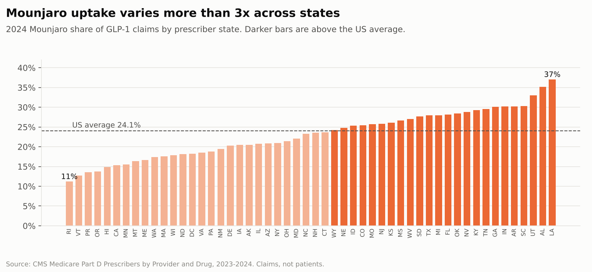
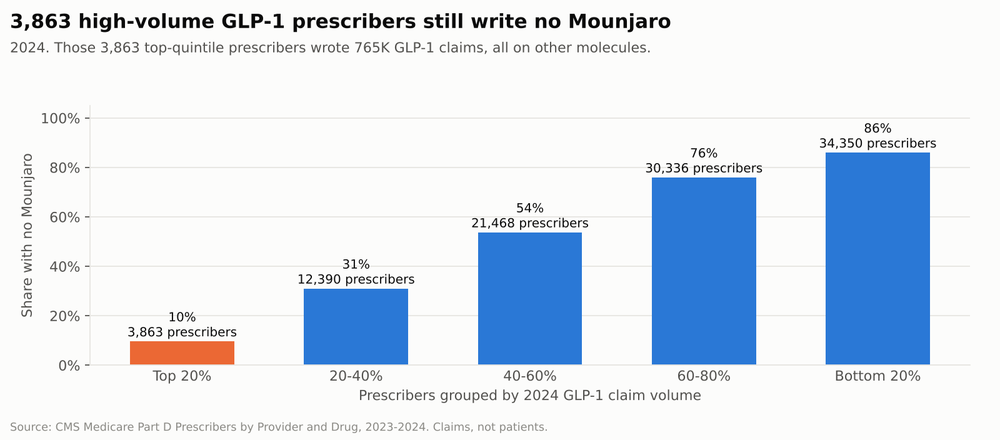

# US GLP-1 Diabetes Market & Prescriber Analysis (Medicare Part D, 2023–24)

Who prescribes GLP-1 diabetes drugs in Medicare, how fast Mounjaro is taking share, and where a brand team should focus next. Built on 752,159 public prescriber-by-drug records from CMS, analysed in MySQL with Python for the data pull and charts.

**The question:** If I were on the Mounjaro (tirzepatide) brand team in early 2025, where is the growth coming from, and which prescribers should we go after?

## Summary

1. **The market grew 40% in a year.** Part D GLP-1 claims rose from 14.0M to 19.5M between 2023 and 2024. Gross drug cost went from $18.9B to $24.5B, and the number of prescribers from 171,400 to 199,615.
2. **Mounjaro took most of the new share.** It went from 11% to 24% of claims (1.5M to 4.7M claims, 3.1x). Trulicity fell from 35% to 20% and was the clear loser. Ozempic still leads with 56%.
3. **This is a primary-care market.** Family and internal medicine, nurse practitioners and physician assistants write 82% of claims. Endocrinologists write 4.7x more per head than a family physician, but there are only 5,879 of them, about 3% of prescribers.
4. **Volume is concentrated.** The top 10% of prescribers (about 20,000 people) write 41% of claims, and 14% of prescribers write half.
5. **There is a defined target list.** 3,863 prescribers in the top fifth by GLP-1 volume wrote no reportable Mounjaro in 2024. Together they wrote 765K GLP-1 claims, all on competing drugs. 69% of them are family or internal medicine physicians.

**Recommendation:** Point reps at the high-volume prescribers who haven't adopted Mounjaro yet, starting with the 3,863 above, rather than at endocrinologists: 89% of them already write Mounjaro, against about 49% of primary-care prescribers. Reach the long tail of primary-care prescribers through non-personal channels such as digital, email and peer programs, because the roughly 100,000 prescribers in the bottom half can't be covered with visits. Use the state spread (11% to 37% Mounjaro share) to decide which regions get resources first, after checking whether low-share states are blocked by formulary access rather than prescriber preference.

## Findings

### 1. Mounjaro more than doubled its share in one year



| Molecule (main brands) | 2023 claims | 2024 claims | 2023 share | 2024 share |
|---|---:|---:|---:|---:|
| Semaglutide (Ozempic, Rybelsus) | 7.17M | 10.91M | 51.3% | 55.9% |
| Tirzepatide (Mounjaro) | 1.52M | 4.69M | 10.9% | 24.1% |
| Dulaglutide (Trulicity) | 4.85M | 3.82M | 34.7% | 19.6% |
| Liraglutide (Victoza) | 0.43M | 0.09M | 3.0% | 0.4% |

Trulicity is the only major brand whose claims fell in absolute terms (−21%). Of the prescribers who wrote Trulicity in 2023, 30,635 no longer had reportable Trulicity volume in 2024. This data has no patient-level detail, so it can't show how much of Mounjaro's growth came from patients switching off Trulicity and how much from patients new to GLP-1s.

Mounjaro's share rose by roughly the same amount in every specialty, from about 10–12% to 23–28%. Endocrinologists lead slightly at 28% vs 23% in family practice. So adoption is spreading across primary care too, not just among specialists. Measured by prescriber rather than claims, though, the gap is wide: 89% of endocrinologists wrote reportable Mounjaro in 2024, compared with 47–51% in family practice, internal medicine, NPs and PAs.

### 2. Primary care writes most claims; endocrinologists write the most per head



The two views point to different targeting strategies. On volume per person, endocrinologists are by far the most valuable accounts. On total volume, the market sits with roughly 180,000 primary-care prescribers. A sales force can cover the first group with visits but not the second.

### 3. A small group of prescribers drives most of the volume



Prescribers in the top decile average about 400 GLP-1 claims each, against a 98 average across all prescribers. The bottom half of prescribers (about 100,000 people) write under 14% of claims between them. Rep time therefore pays back fastest on a defined list of high-volume prescribers.

### 4. Mounjaro uptake varies more than 3x across states



Mounjaro share runs from 11% of claims in Rhode Island to 37% in Louisiana. Most of the high-share states are in the South (LA, AL, SC, AR, GA, TN), and the low-share states are mostly in New England and the West Coast (RI, VT, OR, HI, CA). California is low at 15% even though it's the second-largest GLP-1 market by claims. **This is a hypothesis, not a finding:** the gap could come from Part D plan formularies and prior-authorization rules that differ by region, not from prescriber preference. Plan-level formulary data would be needed to tell the two apart.

### 5. Whitespace: high-volume prescribers who haven't adopted Mounjaro



Among the 149,772 prescribers active in both years:

| Status | Prescribers | Share |
|---|---:|---:|
| No Mounjaro in either year | 63,516 | 42.4% |
| Adopted Mounjaro in 2024 | 43,821 | 29.3% |
| Wrote Mounjaro in both years | 39,956 | 26.7% |
| Dropped below the reporting floor | 2,479 | 1.7% |

Most of the top-quintile prescribers have already adopted Mounjaro. The 3,863 who haven't are the most valuable list in this dataset: each writes about 198 GLP-1 claims a year, roughly double the 98-claim average. Here is who they are:

| Specialty | Target prescribers | Their GLP-1 claims |
|---|---:|---:|
| Family Practice | 1,372 | 260K |
| Internal Medicine | 1,302 | 258K |
| Nurse Practitioner | 506 | 97K |
| Physician Assistant | 209 | 39K |
| Pharmacist | 150 | 37K |
| Endocrinology | 89 | 26K |

## Data and its limits

- **Source:** [CMS Medicare Part D Prescribers – by Provider and Drug](https://data.cms.gov/provider-summary-by-type-of-service/medicare-part-d-prescribers/medicare-part-d-prescribers-by-provider-and-drug), data years 2023 and 2024. Each row is one prescriber × one drug × one year.
- **Medicare only.** These are mostly patients aged 65 and over. Commercial and cash-pay patients are not included.
- **Diabetes only, in practice.** Medicare Part D can't cover drugs used for weight loss. That's why Wegovy has 76K claims against 9.9M for Ozempic, and Zepbound has 14. Read this as the type 2 diabetes GLP-1 market.
- **Claims, not patients.** CMS blanks the beneficiary count when it's under 11, which affects 71% of 2024 rows. Summing patients would undercount badly, so everything here is sized on claims. A claim is one fill, including refills.
- **Small prescribers are missing.** CMS drops any prescriber-drug row with fewer than 11 claims (the minimum in the file is exactly 11). "No Mounjaro" therefore means fewer than 11 Mounjaro claims, not necessarily zero.
- **Gross cost, not net revenue.** `Tot_Drug_Cst` is what was paid at the pharmacy, before manufacturer rebates. Net spend is lower.
- **Specialty** is the CMS-assigned prescriber type, taken from claims or NPPES.

## How to run it

Requirements: Python 3.10+, MySQL 8.0+ (MariaDB 10.6+ also works).

```bash
pip install -r requirements.txt

# 1. Download the data from the CMS API (no key needed; ~1 minute, ~107 MB)
python src/fetch_cms_partd.py

# 2. Load it into MySQL (enable local loads once: SET GLOBAL local_infile = 1;)
mysql --local-infile=1 -u root -p < sql/01_schema_load.sql

# 3. Run the analysis and save every result table to outputs/tables/
MYSQL_USER=root MYSQL_PASSWORD=yourpassword python src/run_analysis.py
#    or read the results directly in the MySQL client:
mysql -u root -p --table partd < sql/02_analysis.sql

# 4. Rebuild the charts in outputs/charts/
python src/make_charts.py
```

## Repo layout

```
sql/01_schema_load.sql     table definition + CSV load
sql/02_analysis.sql        12 named queries (CTEs, window functions)
src/fetch_cms_partd.py     pulls the data from the CMS API, checks every slice arrived complete
src/run_analysis.py        runs each named query, writes outputs/tables/<name>.csv
src/make_charts.py         builds the charts from those tables
outputs/tables/            query results (committed, so you can read them without running anything)
outputs/charts/            the charts used above
data/                      raw CSV lands here (git-ignored, too large for GitHub)
```

## Next steps I'd take with more data

- Join plan-level formulary files to test whether state differences come from access or from preference.
- Add 2025 data when CMS releases it, to see whether Trulicity's decline is levelling off.
- Use NPPES addresses to turn the 3,863-prescriber list into territories.
